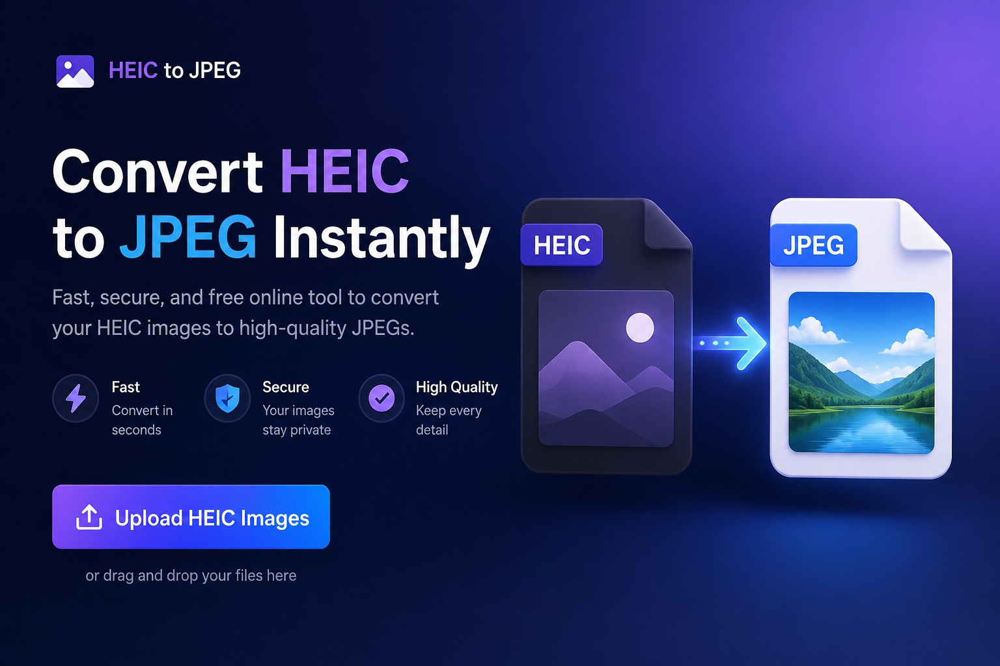

# HEIC to JPG Converter by TCDOVERLORD

A Windows desktop application for converting HEIC and HEIF photos into JPG images. The Rust edition is designed for local processing without photo uploads or an online account.

<p align="center">
  <a href="https://tcdoverlord.github.io/heic-to-jpg-converter-windows/"><strong>Visit the HEIC to JPG Converter Website</strong></a>
</p>

<p align="center">
  
</p>

---

## Features

- Drag and drop photos or select them through the file picker.
- Convert up to 20 photos per batch.
- Choose a destination folder for converted images.
- Adjust JPEG quality; the default is 95%.
- Review conversion results for individual files.
- Leave original photos unchanged.
- Avoid intentionally overwriting existing output files.
- Process photos locally without uploading them to an online service or requiring an account.

## Download and Run

You can run the prebuilt Rust application without installing Rust or compiling the source code.

1. Open the [GitHub Actions build page](https://github.com/tcdoverlord/heic-to-jpg-converter-windows/actions).
2. Open the latest successful **Build Rust Windows App** workflow run.
3. Download the `HEIC-to-JPG-Converter-Windows-x64` artifact.
4. Extract the downloaded artifact ZIP.
5. Run `HEIC-to-JPG-Converter.exe`.

The repository's **Code → Download ZIP** option downloads source files; it is not the same as the packaged Windows build. If no successful workflow run is available, use the build-from-source instructions below.
### Create a Desktop Shortcut

1. Extract the downloaded artifact ZIP to a permanent folder.
2. Right-click `HEIC-to-JPG-Converter.exe`.
3. On Windows 11, select **Show more options** if necessary.
4. Choose **Send to > Desktop (create shortcut)**.
### Windows Security Notice

The prebuilt executable is unsigned, so Windows may display a SmartScreen or security warning. Only run software you trust. Verify the executable's SHA-256 hash when needed. If the app fails to launch, check that you extracted the ZIP completely and kept the release files together.

## Verify the Download

From the extracted repository folder, open PowerShell and run:

```powershell
Get-FileHash ".\build_output\rust\tcd-heic-to-jpg.exe" -Algorithm SHA256
```

Compare the displayed hash with the value in `build_output/rust/SHA256SUMS.txt`. The values must match exactly.

## Build from Source

To build the Rust edition on Windows, you need a stable Rust toolchain and vcpkg with `libheif` installed for the `x64-windows-static-md` triplet.

```powershell
vcpkg install libheif:x64-windows-static-md
$env:VCPKG_ROOT = "C:\DevTools\vcpkg"
cargo build --release
```

These example commands assume vcpkg is installed at `C:\DevTools\vcpkg`; adjust `VCPKG_ROOT` if your installation is elsewhere.

The executable is generated at:

`target\release\tcd-heic-to-jpg.exe`

After a successful [GitHub Actions](https://github.com/tcdoverlord/heic-to-jpg-converter-windows/actions) run, check the workflow run for its Windows x64 build artifact.

## Legacy Python Edition

The original Python application, tests, and build scripts are preserved in [`legacy-python`](legacy-python/README.md).

## Project Documentation

- [Rust edition build notes](docs/RUST_EDITION_README.md)
- [Rust migration notes](docs/RUST_MIGRATION_NOTES.md)
- [Safety guide](docs/SAFETY.md)
- [Testing guide](docs/TESTING.md)
- [Project continuity notes](PROJECT_CONTINUITY.md)

## Recommended Gear: Action Camera

Thinking about buying an action camera? [View my recommended action camera on Amazon](https://amzn.to/4yK3M4H) and check the current product details, included accessories, and customer reviews before deciding.

**Affiliate disclosure:** This project page includes an affiliate link. I may earn a commission from qualifying purchases at no additional cost to you.

## Report a Problem

[Open an issue on GitHub](https://github.com/tcdoverlord/heic-to-jpg-converter-windows/issues). Include your Windows version, the steps you followed, and any error messages that may help reproduce the problem. Do not include sensitive personal information.

## License

See [LICENSE](LICENSE) for the project's license terms.

---

Created and maintained by [TCDOVERLORD](https://github.com/tcdoverlord).
